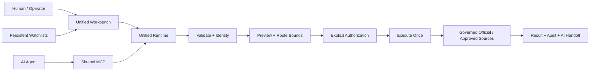
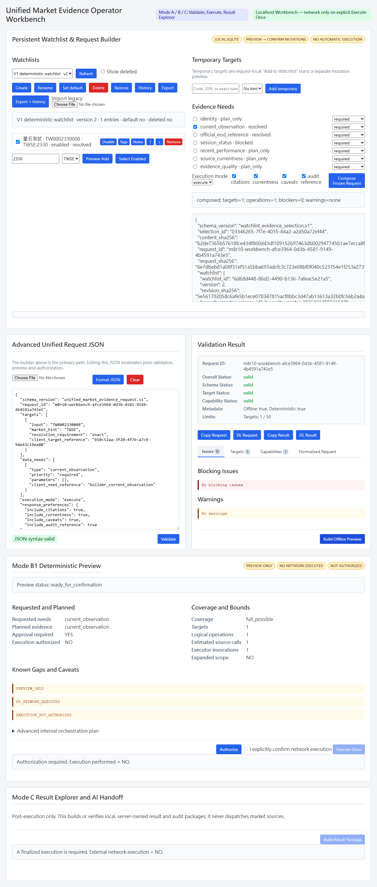

# TW-Market Live Data Intelligence

[English](README.md) | [繁體中文](README.zh-TW.md)

> Local-first, governed Taiwan-market evidence infrastructure for human operators
> and AI agents — validate first, preview bounded work, then explicitly authorize
> one execution only when the current capability and route permit it.

## Architecture at a glance

## Current stable release

**TW-Market `v1.5.0` is the current stable GitHub release.** ProductVersion = `1.5.0`.
It was published on 2026-10-28 from frozen source commit
`acaf726a5b59baee4c5a30521ea5a5d5ec0cec76` and tree
`d44f66dc154c21326ac8b105d2f15fd793f6071b`.

- [GitHub Release v1.5.0](https://github.com/SmartyJohnway/tw-market-live-data-intelligence/releases/tag/v1.5.0)
- [Windows Native ZIP](https://github.com/SmartyJohnway/tw-market-live-data-intelligence/releases/download/v1.5.0/TW-Market-1.5.0-windows-x64.zip)
- [Native SHA-256 sidecar](https://github.com/SmartyJohnway/tw-market-live-data-intelligence/releases/download/v1.5.0/TW-Market-1.5.0-windows-x64.zip.sha256)
- [Windows MCPB](https://github.com/SmartyJohnway/tw-market-live-data-intelligence/releases/download/v1.5.0/tw-market-unified-mcp-v1.5.0-win-x64.mcpb)
- [MCPB SHA-256 sidecar](https://github.com/SmartyJohnway/tw-market-live-data-intelligence/releases/download/v1.5.0/tw-market-unified-mcp-v1.5.0-win-x64.mcpb.sha256)
- [First-party SBOM](https://github.com/SmartyJohnway/tw-market-live-data-intelligence/releases/download/v1.5.0/TW-Market-1.5.0-first-party-sbom.json)
- [Publication manifest](https://github.com/SmartyJohnway/tw-market-live-data-intelligence/releases/download/v1.5.0/TW-Market-1.5.0-publication-manifest.json)

The frozen v1.5.0 tag and SHA-256-verified release assets remain the release
authority even if `main` later advances with post-release documentation or
development work. GitHub Immutable Releases enforcement is not enabled for this
release; the non-mutation requirement is a governance/freeze policy, not a platform lock.

## Choose your path

| Path | Best for | Start here |
|---|---|---|
| **Windows Native ZIP** | Normal local operator / Workbench use | [Download v1.5.0 Native ZIP](https://github.com/SmartyJohnway/tw-market-live-data-intelligence/releases/download/v1.5.0/TW-Market-1.5.0-windows-x64.zip) |
| **Windows MCPB** | AI / MCP client | [Download v1.5.0 MCPB](https://github.com/SmartyJohnway/tw-market-live-data-intelligence/releases/download/v1.5.0/tw-market-unified-mcp-v1.5.0-win-x64.mcpb) |
| **Source checkout** | Developer / contributor | [Source/developer path](docs/operator/QUICK_START.md#path-c--source-checkout-developer--contributor-path) |

For a **60-second orientation and first-run sequence**, use the
[Operator Quick Start](docs/operator/QUICK_START.md). The Native ZIP is the
recommended operator path; source checkout is not the default installation path
for every user.

## What TW-Market is

TW-Market is a governed evidence and research workbench for Taiwan-market data.
It gives a human operator or AI agent a deterministic path from target identity
and capability validation to bounded source acquisition, canonical Result/Audit
materialization, citations, and an AI-ready handoff.

It is intentionally **not** a broker, autonomous trader, portfolio system,
general-purpose crawler, or realtime-price guarantee.

Core product characteristics:

- **Local-first:** installation state, Security Master, Watchlists, evidence, and
  audit artifacts remain under explicit local control.
- **Identity-aware:** Taiwan cash instruments use ISIN as durable identity and
  `MARKET:CODE` as listing/routing identity.
- **Preview before execute:** validation and preview do not authorize network
  acquisition; execution is explicit, bounded, and auditable.
- **Persistent Watchlists are supported:** installation-local Watchlists use immutable
  revisions, optimistic concurrency, and explicit preview/commit mutation.
- **Evidence, not conclusions:** source authority, timing/currentness, missingness,
  caveats, and citations remain visible to downstream humans and AI.

## Governed workflow

A typical `2330` flow is:

1. Create or select an installation-local Watchlist and add `2330`.
2. Compose a Unified Market Evidence Request and validate identity/capability.
3. Preview the exact planned operation and its route boundary.
4. Explicitly authorize one bounded execution only if the preview is executable.
5. Read the canonical Result and Audit Package, or export the AI-ready handoff.

Unified Request v3 is preferred. Request v1/v2 remain supported compatibility
contracts; historical supported Result/Audit packages remain readable without
rewriting their canonical bytes or provenance.

The Unified MCP surface remains exactly six governed tools:

`market_describe_capabilities`, `market_validate_request`,
`market_preview_request`, `market_read_result`,
`market_export_ai_handoff`, and `market_fetch_evidence`.

See the [AI usage guide](docs/agent_usage_guide.md) and
[V1 historical public contracts](docs/contracts/V1_PUBLIC_CONTRACTS.md) for the
current request/result/handoff semantics and compatibility boundary.

View the full Unified Workbench screenshot

## Current evidence capabilities

Current governed product scope includes:

- installation-local Taiwan Market Identity Service and persistent Watchlists;
- official material-disclosure and monthly-revenue evidence for eligible
  TWSE/TPEx company common shares;
- selected bounded market-state, index-futures, institutional-flow,
  corporate-action, and recent-performance context where current Catalog and
  Routing authority make the requested market/target executable;
- canonical Result/Audit lineage, citations, timing/currentness semantics, and
  AI-ready Markdown handoff.

Capability support is not the same as route executability. A known instrument,
schema, or capability does not by itself authorize source acquisition. Always
validate and preview against the current Catalog and selected Routing.

Research evidence is intentionally bounded. It does not imply arbitrary history,
realtime disclosures, a full-market scanner, `financial_summary`, investment
advice, or trading signals.

## Safety boundary

There is **no automatic polling, scheduler, startup market fetch, Watchlist-driven
automatic execution, trading, or order routing**. There is also no silent source
fallback or model-selected executor/URL. Missing evidence is not converted to
zero, and execution success is not presented as a realtime guarantee.

## Source/developer quick start

Use the [primary source first-run sequence](docs/operator/QUICK_START.md#source-first-run)
for dependencies, offline lifecycle initialization, Local Service, Workbench and
MCP preflight. Initialization and Security Master activation are separate:
identity-dependent operations fail closed while identity is unavailable, but
health/UI/capability inspection can start after installation initialization.
The source MCP stdio adapter requires the running loopback Local Service.

The release ZIP/MCPB installation paths are documented separately; keep those
operator instructions distinct from this source/developer path.

## MCP distribution and registry boundary

The current GitHub `v1.5.0` release includes the supported Windows MCPB and its
SHA-256 sidecar. It uses local stdio transport and exposes the same exact six
governed tools as the source launcher.

The public MCP Registry entry
`io.github.SmartyJohnway/tw-market-live-data-intelligence` is a **separate
publication surface**. Its currently published package metadata remains on the
historical `v1.0.0` package until a separately authorized Registry update is
performed. Do not infer Registry publication from the GitHub v1.5.0 release.

See [MCP distribution](docs/distribution/MCP_DISTRIBUTION.md) for installation,
integrity, and Security Master boundaries.

Docker is validated as a release/provenance surface for `linux/amd64`, but
v1.5.0 does not publish a Docker registry image.

## Documentation

Operator and product docs:

- [Operator quick start](docs/operator/QUICK_START.md)
- [Local Workbench guide](docs/operator/LOCAL_WORKBENCH.md)
- [Troubleshooting](docs/operator/TROUBLESHOOTING.md)
- [AI / agent usage guide](docs/agent_usage_guide.md)
- [AI discovery entry (`llms.txt`)](llms.txt)
- [Capability matrix](docs/reference/CAPABILITY_MATRIX.md)
- [Source matrix](docs/reference/SOURCE_MATRIX.md)
- [Documentation index](docs/INDEX.md)

Engineering/governance front doors:

- [PROJECT.md](PROJECT.md) — current project/product authority
- [ROADMAP.md](ROADMAP.md) — canonical Roadmap V3.2
- [HANDOFF.md](HANDOFF.md) — current operational handoff
- [AGENTS.md](AGENTS.md) — repository and AI collaboration rules

Historical engineering and acceptance records remain available for audit and
compatibility, but they are not a second current-product contract. Start with
[Project History](docs/PROJECT_HISTORY.md) or the
[Engineering history / protocol archive](docs/INDEX.md#engineering-history--protocol-archive).

## Release history and provenance

- **`v1.5.0`** — current stable GitHub release; frozen source and final release
  assets passed the Phase L release-governance and publication acceptance chain.
- **`v1.0.0`** — historical stable release and current MCP Registry package
  until a separately authorized Registry update occurs.
- **`v1.0.0-rc.1`** — historical prerelease.
- **`v0.1.0`** — earlier stable GitHub release.

The v1.5.0 publication includes the Native ZIP/checksum, MCPB/checksum,
first-party SBOM, and typed publication manifest. SHA-256/provenance/SBOM are
integrity and traceability controls; they are not cryptographic publisher
signatures.

## Contributing and security

Read [CONTRIBUTING.md](CONTRIBUTING.md) before opening a pull request. Report
security concerns using [SECURITY.md](SECURITY.md). Never commit credentials,
tokens, cookies, or private market payloads.

## License

See [LICENSE](LICENSE).
