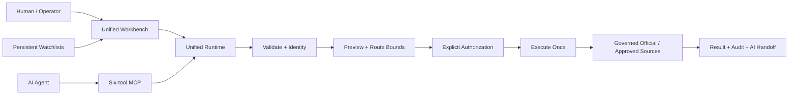

# TW-Market Live Data Intelligence

[English](README.md) | [繁體中文](README.zh-TW.md)

> 提供給操作人員與 AI Agent 的本機優先、受治理台灣市場證據基礎設施：
> 先驗證、再預覽受界限工作，只有在目前能力與路由允許時，才明確授權一次執行。

## 架構一覽

## 目前穩定版本

**TW-Market `v1.5.0` 是目前的 stable GitHub release。** ProductVersion = `1.5.0`。
它於 2026-10-28 正式發布，凍結來源 commit 為
`acaf726a5b59baee4c5a30521ea5a5d5ec0cec76`，source tree 為
`d44f66dc154c21326ac8b105d2f15fd793f6071b`。

- [GitHub Release v1.5.0](https://github.com/SmartyJohnway/tw-market-live-data-intelligence/releases/tag/v1.5.0)
- [Windows Native ZIP](https://github.com/SmartyJohnway/tw-market-live-data-intelligence/releases/download/v1.5.0/TW-Market-1.5.0-windows-x64.zip)
- [Native SHA-256 sidecar](https://github.com/SmartyJohnway/tw-market-live-data-intelligence/releases/download/v1.5.0/TW-Market-1.5.0-windows-x64.zip.sha256)
- [Windows MCPB](https://github.com/SmartyJohnway/tw-market-live-data-intelligence/releases/download/v1.5.0/tw-market-unified-mcp-v1.5.0-win-x64.mcpb)
- [MCPB SHA-256 sidecar](https://github.com/SmartyJohnway/tw-market-live-data-intelligence/releases/download/v1.5.0/tw-market-unified-mcp-v1.5.0-win-x64.mcpb.sha256)
- [First-party SBOM](https://github.com/SmartyJohnway/tw-market-live-data-intelligence/releases/download/v1.5.0/TW-Market-1.5.0-first-party-sbom.json)
- [Publication manifest](https://github.com/SmartyJohnway/tw-market-live-data-intelligence/releases/download/v1.5.0/TW-Market-1.5.0-publication-manifest.json)

即使 `main` 後續因發布後文件維護或新開發而繼續前進，已凍結的 `v1.5.0`
tag 與經 SHA-256 驗證的 release assets 仍是該版本的正式發行 authority。
GitHub 並未對此 release 啟用 Immutable Releases 強制機制；這裡的不變更要求
屬於治理／freeze policy，而不是平台層技術鎖定。

## 選擇使用路徑

| 路徑 | 適合對象 | 開始方式 |
|---|---|---|
| **Windows Native ZIP** | 一般本機操作／Workbench 使用者 | [下載 v1.5.0 Native ZIP](https://github.com/SmartyJohnway/tw-market-live-data-intelligence/releases/download/v1.5.0/TW-Market-1.5.0-windows-x64.zip) |
| **Windows MCPB** | AI／MCP client | [下載 v1.5.0 MCPB](https://github.com/SmartyJohnway/tw-market-live-data-intelligence/releases/download/v1.5.0/tw-market-unified-mcp-v1.5.0-win-x64.mcpb) |
| **Source checkout** | 開發者／貢獻者 | [Source／developer 路徑](docs/operator/QUICK_START.md#path-c--source-checkout-developer--contributor-path) |

要在 **60 秒內掌握入口與第一次啟動流程**，請直接依照
[Operator Quick Start](docs/operator/QUICK_START.md)。Native ZIP 是建議的一般操作入口；
source checkout 不再是所有使用者的預設安裝路徑。

## TW-Market 是什麼

TW-Market 是面向台灣市場資料的受治理證據與研究工作台。它讓操作人員或
AI Agent 可以沿著一條可追溯路徑，從目標身分與能力驗證開始，進入受界限的
來源取得、canonical Result / Audit materialization、引用與 AI-ready handoff。

它刻意**不是**券商、自治交易 Agent、投資組合系統、通用型 crawler，也不提供
即時價格保證。

核心產品特性：

- **Local-first：** 安裝狀態、Security Master、Watchlists、evidence 與 audit
  artifacts 都維持在明確的本機控制範圍內。
- **Identity-aware：** 台灣現貨證券以 ISIN 作為 durable identity，
  `MARKET:CODE` 作為 listing / routing identity。
- **Preview before execute：** validation 與 preview 不等於允許 network
  acquisition；真正執行必須明確、受界限且可稽核。
- **Persistent Watchlists：** 安裝本機 Watchlist 具有 immutable revisions、
  optimistic concurrency 與明確 preview/commit mutation。
- **Evidence, not conclusions：** source authority、timing/currentness、missingness、
  caveat 與 citation 都必須保留給後續的人與 AI 使用。

## 受治理工作流程

以 `2330` 為例：

1. 建立或選取安裝本機 Watchlist，加入 `2330`。
2. 組成 Unified Market Evidence Request，驗證身分與能力。
3. 預覽實際計畫操作與 route boundary。
4. 只有在 preview 顯示可執行時，才明確授權一次受界限執行。
5. 讀取 canonical Result 與 Audit Package，或匯出 AI-ready handoff。

Unified Request v3 是現行偏好契約。Request v1/v2 仍保留相容性；既有受支援的
Result / Audit 歷史套件持續可讀，不重寫其 canonical bytes 或 provenance。

Unified MCP surface 固定維持六個受治理工具：

`market_describe_capabilities`、`market_validate_request`、
`market_preview_request`、`market_read_result`、
`market_export_ai_handoff`、`market_fetch_evidence`。

目前 request / result / handoff semantics 與相容性邊界請見
[AI usage guide](docs/agent_usage_guide.md) 與
[V1 historical public contracts](docs/contracts/V1_PUBLIC_CONTRACTS.md)。

查看完整 Unified Workbench 截圖

## 目前 evidence 能力

現行受治理產品範圍包括：

- 安裝本機 Taiwan Market Identity Service 與 persistent Watchlists；
- 對符合資格的 TWSE/TPEx company common shares 取得官方重大訊息與月營收證據；
- 在 current Catalog 與 Routing authority 判定該 market / target 可執行時，
  提供受界限的 market-state、index-futures、institutional-flow、
  corporate-action 與 recent-performance context；
- canonical Result / Audit lineage、citation、timing/currentness semantics 與
  AI-ready Markdown handoff。

Capability support 不等於 route executability。已知 instrument、schema 或
capability 本身都不會自動授權 source acquisition；必須依 current Catalog 與
selected Routing 進行 validate / preview。

Research evidence 本來就具有明確範圍，不代表任意歷史查詢、即時重大訊息、
全市場掃描、`financial_summary`、投資建議或交易訊號。

## 安全邊界

系統**不提供自動輪詢、排程器、啟動時市場取得、Watchlist 驅動自動執行、
交易或下單**；也不進行 silent source fallback 或由 model 自行挑選 executor / URL。
缺失資料不會被轉成 0，執行成功也不會被描述成即時行情保證。

## Source / developer 快速開始

請依[主要 source first-run 流程](docs/operator/QUICK_START.md#source-first-run)
安裝依賴、離線執行 lifecycle init，再啟動 Local Service 與 Workbench，並檢查 MCP。
Installation 初始化與 Security Master 啟用是不同狀態：初始化後即可使用
health、UI 與 capability inspection；需要 identity 的操作仍會在身分權威不可用時
fail closed。Source MCP stdio adapter 需要持續運作的 loopback Local Service。

Release ZIP / MCPB 請依各自的 operator / distribution 安裝流程處理。

## MCP 發行與 Registry 邊界

目前 GitHub `v1.5.0` release 已包含受支援的 Windows MCPB 與 SHA-256 sidecar，
採用本機 stdio transport，提供與 source launcher 相同的固定六個受治理工具。

公開 MCP Registry entry
`io.github.SmartyJohnway/tw-market-live-data-intelligence` 是**獨立的 publication
surface**。在另行授權 Registry update 之前，其目前已發布的 package metadata
仍維持歷史 `v1.0.0` package。不可因 GitHub 已發布 v1.5.0，就推論 MCP Registry
也已同步發布 v1.5.0。

安裝範圍、完整性與 Security Master 邊界請見
[MCP 發行說明](docs/distribution/MCP_DISTRIBUTION.md)。

Docker 已作為 `linux/amd64` release / provenance validation surface 完成驗證，
但 v1.5.0 並沒有發布 Docker registry image。

## 文件入口

Operator 與產品文件：

- [操作人員快速開始](docs/operator/QUICK_START.md)
- [Local Workbench guide](docs/operator/LOCAL_WORKBENCH.md)
- [Troubleshooting](docs/operator/TROUBLESHOOTING.md)
- [AI / Agent usage guide](docs/agent_usage_guide.md)
- [AI discovery entry (`llms.txt`)](llms.txt)
- [Capability matrix](docs/reference/CAPABILITY_MATRIX.md)
- [Source matrix](docs/reference/SOURCE_MATRIX.md)
- [文件索引](docs/INDEX.md)

Engineering / governance 入口：

- [PROJECT.md](PROJECT.md)：目前專案／產品 authority
- [ROADMAP.md](ROADMAP.md)：canonical Roadmap V3.2
- [HANDOFF.md](HANDOFF.md)：目前 operational handoff
- [AGENTS.md](AGENTS.md)：repository 與 AI collaboration rules

歷史工程與 acceptance records 會持續保留作 audit 與 compatibility 使用，但不構成
第二套 current-product contract。請由 [Project History](docs/PROJECT_HISTORY.md) 或
[Engineering history / protocol archive](docs/INDEX.md#engineering-history--protocol-archive)
進入歷史資料。

## Release 歷史與 provenance

- **`v1.5.0`**：目前 stable GitHub release；frozen source 與 final release assets
  已通過 Phase L release-governance 與 publication acceptance chain。
- **`v1.0.0`**：歷史 stable release；在另行授權 Registry update 前，仍是目前
  MCP Registry 所發布的 package。
- **`v1.0.0-rc.1`**：歷史 prerelease。
- **`v0.1.0`**：更早的 stable GitHub release。

v1.5.0 publication 包含 Native ZIP / checksum、MCPB / checksum、first-party SBOM
與 typed publication manifest。SHA-256 / provenance / SBOM 是完整性與追溯控制，
不是 cryptographic publisher signature。

## 參與與安全回報

建立 pull request 前請先閱讀 [CONTRIBUTING.md](CONTRIBUTING.md)。安全問題請依
[SECURITY.md](SECURITY.md) 回報。禁止提交 credentials、tokens、cookies 或私人市場資料。

## License

請見 [LICENSE](LICENSE)。
