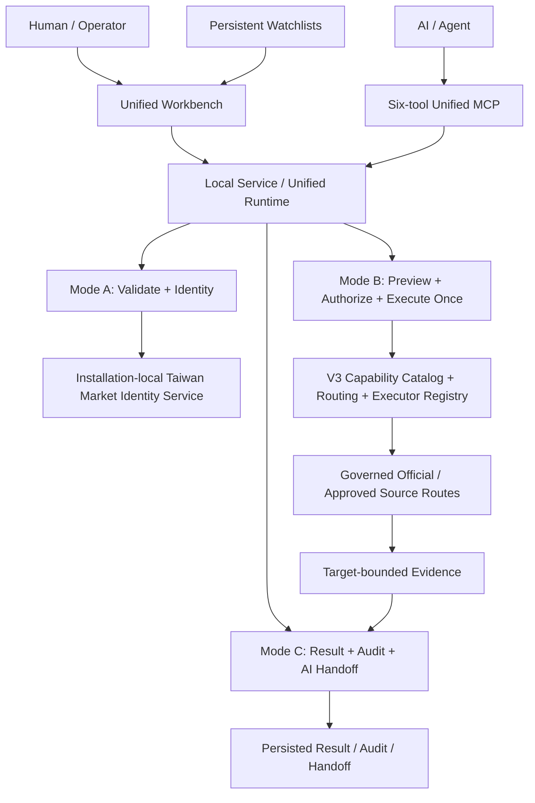

# Current Product Architecture

## Core properties

- local-first state and execution authority;
- installation-local Security Master;
- ISIN durable cash-security identity;
- `MARKET:CODE` listing/routing identity;
- Unified Request/Result family;
- V3 preferred, V1/V2 compatible;
- explicit preview/authorization/execute-once boundary;
- six MCP tools sharing the same runtime semantics as Workbench;
- bounded network acquisition;
- explicit missing/partial/failure/currentness semantics;
- no trading.

## Current selected routing shape

Architecture support does not by itself activate a route. Current machine-readable
Routing selects bounded executors for `current_observation`, `official_eod_reference`,
`material_disclosures`, `monthly_revenue`, TPEx `trading_status_context`, TWSE/TPEX
`market_state_context`, TWSE `index_futures_context`, TWSE/TPEX
`cash_institutional_flow_context`, TWSE `recent_performance`, and TWSE
`corporate_action_context`.

Important non-executable boundaries remain explicit: `session_status` is blocked
with no selected executor; `identity`, `source_currentness`, and `evidence_quality`
are plan-only through this routing surface; TPEx recent-performance/corporate-action
routes remain non-executable; and H1/H2 coverage remains intentionally partial.

## Historical architecture

M5F/M5K/M5N and Level-1/Level-2 architecture documents are historical
provenance. They explain how the product evolved but are not the current product
architecture authority.
